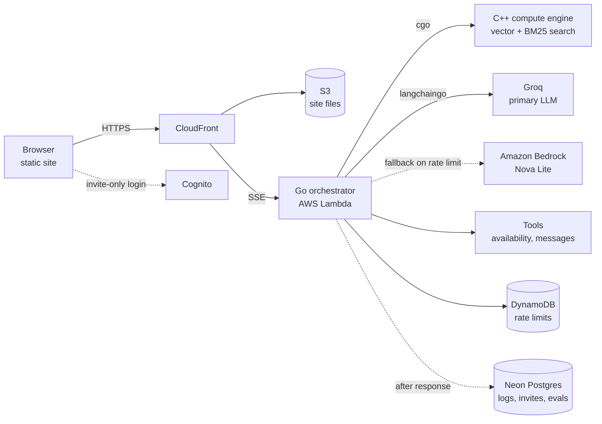

# ferrante-ltd.com — Agentic RAG Receptionist

> **Status: planning.** Nothing below is built yet. This README is the north star; the design
> spec and step-by-step plan will live in [`docs/`](docs/).

A fast, intelligent, transparent AI receptionist for my portfolio site. Visitors ask questions about
me and my work; the receptionist answers from my own documents (RAG), cites its sources, can take
actions through tools, and **shows its work**: you watch it think on the left and watch the backend
act on the right, with real measured timings.

**Goals:** prove *speed* and *intelligence* of responses, at nearly $0 a month.

## What you see

```
┌──────────────────────────────────┬──────────────────────────────────┐
│  THOUGHT STREAM (terminal view)  │  ACTION CARDS                    │
│                                  │                                  │
│  > rewriting follow-up question  │  ┌────────────────────────────┐  │
│  > retrieving: "go experience"   │  │ ● Retrieval (C++)   0.4 ms │  │
│  > 4 chunks, top score 0.82      │  └────────────────────────────┘  │
│  > plan: answer + offer meeting  │  ┌────────────────────────────┐  │
│  > calling check_availability    │  │ ● check_availability  8 ms │  │
│                                  │  └────────────────────────────┘  │
│  Answer: ... [1] [2]             │  ┌────────────────────────────┐  │
│                                  │  │ ● Inference (Groq)         │  │
│  [ suggested questions ]         │  │   TTFT 210 ms · 480 tok/s  │  │
│  [ chat input              ⏎ ]   │  │   cached prompt: 1.9k tok  │  │
│                                  │  │ ✓ Judge: grounded          │  │
│                                  │  └────────────────────────────┘  │
└──────────────────────────────────┴──────────────────────────────────┘
```

- **Left — Thought stream:** a terminal-style view of the model's reasoning and the agent's steps,
  streamed in real time over **Server-Sent Events (SSE)**, followed by the answer with numbered
  citations.
- **Right — Action cards:** one card per backend step (retrieval, each tool call, inference,
  judge). A card lights up the instant Go starts the step and shows its **measured** duration when
  it finishes. Numbers are always real, never mocked.
- **Suggested questions:** chips for the most common questions. Their answers are generated,
  judge-verified and stored at deploy time, so they appear instantly (`Inference: 0 ms
  (pre-verified)`), a direct contrast with live answers.

Both panes are driven by a single SSE stream with typed events:

| Event | Drives | Payload |
|---|---|---|
| `thought` | left pane | reasoning / step text |
| `token` | left pane (answer) | answer text chunk |
| `citation` | both | chunk id, source title, link |
| `step_start` | right pane | step id, kind, label |
| `step_end` | right pane | step id, duration, provider, token counts, status |
| `judge` | right pane | verdict, unsupported claims |
| `done` / `error` | both | totals / error code |

## Architecture



| Layer | Tech | Responsibility |
|---|---|---|
| Frontend | HTML/CSS/JS, no framework; S3 + CloudFront | Split-pane UI, SSE client |
| Orchestrator | **Go** on AWS Lambda (`provided.al2023`), response streaming | Agent loop, tool calls, authorization, timing, SSE |
| Compute engine | **C++**, linked into Go via **cgo** | In-memory vector similarity + BM25 hybrid retrieval |
| LLM framework | **langchaingo** | Groq (OpenAI-compatible API) and Ollama behind one interface |
| Models | Groq **gpt-oss-120b** (answers), **gpt-oss-20b** (judge, rewrites); Bedrock Nova Lite fallback; Ollama locally | See [Model routing](#model-routing) |
| Auth | Amazon Cognito (self-sign-up disabled) | Invitation-only features |
| Rate limits | DynamoDB | Per-IP limits on the hot path, single-digit ms |
| Database | **Neon** serverless Postgres (same AWS region as Lambda) | Conversation logs, analytics, invite records, eval results |
| Infra | OpenTofu | Reproducible AWS setup |

**Why these choices**
- **The model is the speed lever, not the server.** Most of a response's time is spent generating
  text. Groq's LPU hardware generates ~500–1,000 tokens/s, against ~50–150 tokens/s for typical
  hosted models, so a full answer arrives in under a second, and visible reasoning costs almost no
  extra time.
- **Lambda + Go:** fast cold starts (~150–300 ms after idle, reduced by a scheduled keep-warm
  ping), nothing bills while idle, and response streaming carries SSE.
- **C++ in-process via cgo:** see [Retrieval engine](#retrieval-engine). No network hop, and fewer
  moving parts than a separate gRPC service.
- **Neon:** free tier, Postgres in the same AWS region, built-in connection pooling (Lambda opens
  many connections), scales to zero.

## Model routing

Every model sits behind one small Go `Model` interface, so providers are swappable by config and
fallbacks are automatic.

| Job | Model | Why |
|---|---|---|
| Answer + visible reasoning | Groq gpt-oss-120b | Strongest free option; ~500 tok/s |
| Judge, follow-up rewriting | Groq gpt-oss-20b | ~1,000 tok/s; simple tasks; separate rate-limit pool |
| Fallback (Groq rate limit / outage) | Bedrock Nova Lite, via the AWS SDK `ConverseStream` API | Pay-per-token cents; the action card shows which provider answered |
| Local dev + adversarial tests | Ollama, small 3–4B model | $0; fits in 15 GB RAM |

langchaingo is used for Groq (via its OpenAI-compatible provider with a custom base URL) and
Ollama. Bedrock uses a direct AWS SDK adapter because langchaingo v0.1.15's Bedrock provider has no
streaming or tool calling for Nova models.

The final production model choice is made by the [evals](#evaluation-and-safety), not by
benchmarks.

## Request lifecycle

1. **Rate limit** check (DynamoDB) and **auth** check: the Cognito JWT is verified locally against
   cached public keys, and groups come from the token. No database call.
2. **Suggested question?** Serve the stored, pre-verified answer. Done.
3. **Rewrite** the question into a standalone one, *only* if there is chat history.
4. **Embed** the question.
5. **Retrieve** with the C++ engine: hybrid vector + BM25, then filter by the caller's access level.
6. **Generate** with streaming reasoning and tool calls; tool calls are authorized in Go.
7. **Judge** groundedness in parallel with the end of streaming; publish the verdict.
8. **After the response:** write the conversation and timings to Postgres. Never on the hot path.

## Performance

- **Database off the hot path.** Nothing a visitor waits for touches Postgres, so Neon's
  scale-to-zero resume (a few hundred ms) is never visible.
- **Prompt order for caching:** system prompt → tool definitions → *cache point* → retrieved
  chunks → conversation → question. Static content first, so the provider can reuse it. Cache
  hits are reported on the inference card and asserted in tests.
- **Constrained JSON** for tool arguments and the judge verdict (JSON schema / grammar-constrained
  output). Go still validates every result against the schema, because a grammar guarantees valid
  JSON, not correct values.
- **Pre-generated answers** for suggested questions (zero inference).
- **Rewrite only when needed:** skip the extra LLM call on first messages.
- **Sub-millisecond retrieval**, enforced by a benchmark test.

## Retrieval engine

The corpus is small (≈1–2k chunks), so the fastest *correct* method is **exact brute-force
search**. Approximate indexes (HNSW) only pay off at ~100k+ vectors and give up some accuracy.

- Vectors normalized at build time, so cosine similarity is a dot product.
- SIMD (AVX2/FMA on x86, NEON on ARM) and a compact layout (optionally int8) that stays in CPU
  cache.
- Partial top-k with a heap, not a full sort.
- **BM25** over an inverted index catches exact terms vector search misses; the two result lists
  are merged with **Reciprocal Rank Fusion**.
- **Content at two levels:** a summary chunk per project plus detailed chunks. Broad questions hit
  summaries; specific ones hit details.
- **A `faq/` corpus** of real questions with my own answers, the highest-quality source.
- Benchmark target: **< 1 ms per query** on Lambda (≥ 1,769 MB memory, so it gets a full vCPU).

## Invitation-only features

Self-sign-up is disabled in Cognito; an invitation *is* an account I create. Invitees sign in with
a one-time email code (no password). They unlock:

- **Action tools**: e.g. request a meeting, send me a message.
- **Private documents**: extra material retrieved only for authenticated users.

Access is enforced **in Go code** on every tool call and retrieval, never by asking the model to
behave. A jailbroken model still cannot call a tool the caller isn't authorized for.

**Cognito vs Postgres:** Cognito is the authority on *who someone is* (identity, login, groups).
Postgres holds records *about* invites: who invited them, a note, status. A Go CLI
(`invite add <email> --note "..."`) writes to Cognito first, then Postgres, so there's never a
Postgres invite without a real account.

## Evaluation and safety

**Golden dataset**: questions with expected answers and expected source chunks, stored in
Postgres with every eval run's results so quality is tracked over time.
- **Retrieval score:** does the right chunk appear in the top 5? Plain tests, no LLM needed.
- **Answer score:** an LLM judge compares answers to the expected answers.
Scoring them separately shows whether a bad answer came from search or from the model.

**Live judge**: a second model call checks each claim in the answer against the retrieved chunks
and returns `grounded`, `partially_grounded`, or `ungrounded` with the unsupported claims. Its
output is constrained to that schema, so injected text can't make it say anything else.

**Adversarial (red-team) suite**: a versioned corpus in [`evals/adversarial/`](evals/), each
attack with an expected safe outcome:
- direct jailbreaks and role-play escapes
- system-prompt extraction
- indirect prompt injection hidden in retrieved documents
- tool abuse: anonymous users trying to trigger invite-only tools
- private-document leakage to anonymous users
- stored injection: text planted in conversations must never reach retrieval
- off-topic and cost-abuse prompts

## Privacy

- A notice by the chat box: conversations are logged to improve answers.
- Logs reference the Cognito user ID, never email.
- Messages older than 90 days are deleted automatically.
- Logs are **never** fed back into retrieval.

## Testing strategy

Test-first throughout.

| Level | Tooling | Runs |
|---|---|---|
| C++ unit tests + benchmark | doctest (single header) | every commit |
| Go unit tests | `go test`, fake `Model` | every commit (CI) |
| SSE contract tests | Go, recorded event streams | every commit (CI) |
| Retrieval evals | Go, golden dataset | every commit (CI) |
| Answer + adversarial evals | Go harness against **Ollama** | locally / on demand ($0) |
| Smoke tests on AWS | `curl` against the deployed URL | after deploy |

## Cost

| Item | Monthly cost |
|---|---|
| S3 + CloudFront (flat-rate Free plan), Route 53 DNS, ACM | $0 |
| Lambda, DynamoDB, Cognito (≤10k MAU) | $0 (always-free tiers) |
| Groq (free tier: ~30 req/min, ~200k tokens/day on gpt-oss-120b) | $0 |
| Neon Postgres (free: 0.5 GB, 100 compute-hours) | $0 |
| Groq API key in SSM Parameter Store (standard) | $0 |
| Bedrock fallback | cents, only when Groq is rate-limited |
| Domain (`.com`) | ≈ $15/year |

Spend guards: per-IP rate limit, Lambda concurrency cap, max tokens per reply, and an AWS Budget
alarm. *All prices and limits to be re-verified against official pages before deploy.*

## Repository layout (planned)

```
web/            static frontend (split-pane UI, SSE client)
orchestrator/   Go: Lambda handler, agent loop, tools, SSE, Model interface
engine/         C++: retrieval engine + C ABI header for cgo
corpus/         source documents, faq/, project summaries
evals/          golden dataset, adversarial corpus, eval harness
infra/          OpenTofu
docs/           design spec, plan, decisions
```

## Local development (planned)

Requires Go, a C++17 compiler, CMake, and [Ollama](https://ollama.com) running natively.

```bash
ollama serve                 # start Ollama (stop with Ctrl+C or `systemctl stop ollama`)
ollama pull <small-model>    # a 3–4B model; check disk space first
make test                    # C++ + Go tests
make dev                     # run orchestrator locally against Ollama
```

## Open decisions

- [ ] Final production models, decided from eval results
- [ ] Exact tool list for invitees
- [ ] Confirm Cognito passwordless email sign-in is in the free tier
- [ ] Confirm prompt-caching support and minimum prefix length per provider
- [ ] Confirm current Groq free-tier limits and data-use terms

## Known risks

- **cgo binary on Lambda without Docker:** Ubuntu 26.04's glibc is newer than Amazon Linux 2023's.
  Plan: static linking or `zig cc`, proven by a hello-world spike before real work.
- **Go response streaming on Lambda:** confirm `aws-lambda-go` streaming with Function URLs + SSE
  in the same spike.
- **Free tiers change.** Groq, Neon and AWS free tiers can shrink; the `Model` interface and
  Bedrock fallback limit the blast radius for the LLM.
