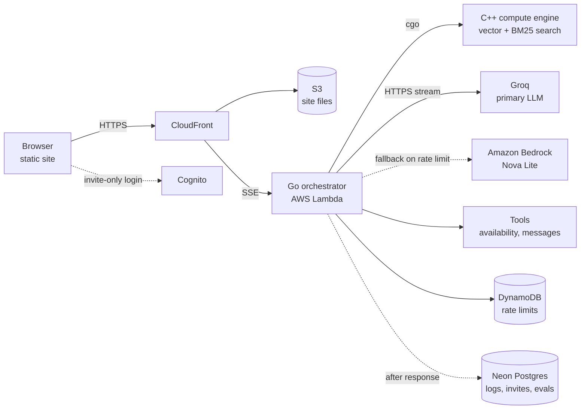

# cferrante-dev — Context Concierge (agentic RAG)

> **Status: built and evaluated locally; not deployed yet.** Phases 0–6.3 of the
> [plan](docs/plan.md) are done: AWS risk spikes, the C++ retrieval engine, the Go orchestrator,
> the split-pane UI, real models (Groq with a Bedrock fallback, Titan embeddings), a golden
> question set with a retrieval gate in CI, and an answer judge checked against hand labels.
> Next is the adversarial suite (6.4), then a private deploy on AWS (Phase 7). See
> [Progress](#progress) for what is measured and what is still a target.
>
> The design spec is in [docs/design.md](docs/design.md), the build order in
> [docs/plan.md](docs/plan.md), targets and measured results in
> [docs/benchmarks.md](docs/benchmarks.md), and every term is explained in
> [docs/concepts.md](docs/concepts.md).

A fast, intelligent, transparent AI assistant for my portfolio site: the **Context Concierge** (the
name is configurable, `ASSISTANT_NAME`). Visitors ask questions about me and my work; the
Context Concierge answers from my own documents ([RAG](docs/concepts.md#rag)), cites its sources, can take
actions through tools, and **shows its work**: you watch it think on the left and watch the backend
act on the right, with real measured timings.

**Goals:** prove *speed* and *intelligence* of responses, at nearly $0 a month.

## Progress

| Milestone | Proves | Status |
|---|---|---|
| **M1 Risks retired** | cgo on Lambda, Go SSE streaming, CloudFront passthrough, Groq speed | ✅ 2026-11-01 |
| **M2 Local end-to-end** | Full chat with thought stream and action cards on my laptop | ✅ 2026-11-02 |
| **M3 Safe and smart** | Real models, judge, golden + adversarial evals passing | In progress: 6.0–6.3 done, 6.4 (adversarial) next |
| **M4 Private deploy** | Running on AWS, reachable only by me | Not started (Phase 7) |
| **M5 Public launch** | Invite-only features, logging, privacy, measured benchmarks | Not started (Phases 8–10) |

**Measured so far** (method and every run in [docs/benchmarks.md](docs/benchmarks.md#results)):

| What | Result | Where |
|---|---|---|
| Hybrid retrieval, 2k chunks × 512 dims | p50 0.122 ms, p99 0.225 ms | Laptop; CI fails the build at p99 ≥ 1 ms |
| C++ vs pure Go, vector top-k | 0.097 ms vs 0.408 ms p50 | Laptop, same day, same contract |
| Groq gpt-oss-120b from Lambda | TTFT p50 198 ms, 483 tokens/s | Spike 1.5, n = 20 |
| Lambda cold start, Go + SSM key read | 205 ms | Spike 1.5, n = 1 |
| Retrieval hit@5, Titan embeddings | 58 / 61 public questions | CI gate at 0.95 |
| Answer evals, judged on Groq | 49 / 64 public questions pass (77%) | Baseline at temperature 0; report-only until run-to-run spread is measured |
| Suggested question, stored answer | p50 0.9 ms | `make dev` over loopback, n = 20 |
| CSS shipped | 1,894 bytes gzipped | Budget 15 KB, checked in CI |

End-to-end targets in the [latency budget](docs/benchmarks.md#latency-budget-one-live-chat-turn-warm-lambda)
(for example, first visible thought) are design targets until Phase 7 measures them on AWS.

## What you see

```
┌──────────────────────────────────┬──────────────────────────────────┐
│  THOUGHT STREAM (terminal view)  │  ACTION CARDS                    │
│                                  │                                  │
│  > rewriting follow-up question  │  ┌────────────────────────────┐  │
│  > retrieving: "go experience"   │  │ ● Retrieval (C++)   0.4 ms │  │
│  > 4 chunks, top score 0.82      │  └────────────────────────────┘  │
│  > plan: answer + offer meeting  │  ┌────────────────────────────┐  │
│  > calling check_availability    │  │ ● check_availability  8 ms │  │
│                                  │  └────────────────────────────┘  │
│  Answer: ... [1] [2]             │  ┌────────────────────────────┐  │
│                                  │  │ ● Inference (Groq)         │  │
│  [ suggested questions ]         │  │   TTFT 210 ms · 480 tok/s  │  │
│  [ chat input              ⏎ ]   │  │   cached prompt: 1.9k tok  │  │
│                                  │  │ ✓ Judge: grounded          │  │
│                                  │  └────────────────────────────┘  │
└──────────────────────────────────┴──────────────────────────────────┘
```

- **Left — Thought stream:** a terminal-style view of the model's reasoning and the agent's steps,
  streamed in real time over **[Server-Sent Events (SSE)](docs/concepts.md#sse)**, followed by the answer with numbered
  citations.
- **Right — Action cards:** one card per backend step (retrieval, each tool call, inference,
  judge). A card lights up the instant Go starts the step and shows its **measured** duration when
  it finishes. Numbers are always real, never mocked.
- **Suggested questions:** chips for the most common questions. Their answers are generated,
  judge-verified and stored at deploy time, so they appear instantly (`Inference: 0 ms
  (pre-verified)`), a direct contrast with live answers.

Both panes are driven by a single SSE stream with typed events:

| Event | Drives | Payload |
|---|---|---|
| `thought` | left pane | reasoning / step text |
| `token` | left pane (answer) | answer text chunk |
| `citation` | both | chunk id, source title, link |
| `step_start` | right pane | step id, kind, label |
| `step_end` | right pane | step id, duration, provider, token counts, status |
| `judge` | right pane | verdict, unsupported claims |
| `done` / `error` | both | totals / error code |

## Architecture



| Layer | Tech | Responsibility |
|---|---|---|
| Frontend | HTML/JS, no framework; **Tailwind CSS v4** (standalone CLI); S3 + CloudFront | Split-pane UI, SSE client |
| Orchestrator | **Go** on AWS Lambda (`provided.al2023`), response streaming | Agent loop, tool calls, authorization, timing, SSE |
| Compute engine | **C++**, linked into Go via **[cgo](docs/concepts.md#cgo)** | In-memory vector similarity + BM25 hybrid retrieval |
| Model clients | **Go standard library** (Groq, Ollama); AWS SDK for Go v2 (Bedrock) | Every provider behind one small `Model` interface; no LLM framework |
| Models | Groq **gpt-oss-120b** (answers), **gpt-oss-20b** (judge, rewrites); Bedrock Nova Lite fallback; Ollama locally | See [Model routing](#model-routing) |
| Auth | Amazon Cognito (self-sign-up disabled) | Invitation-only features |
| Rate limits | DynamoDB | Per-IP limits on the hot path, single-digit ms |
| Database | **Neon** serverless Postgres (same AWS region as Lambda) | Conversation logs, analytics, invite records, eval results |
| Infra | [OpenTofu](docs/concepts.md#infrastructure-as-code) | Reproducible AWS setup |

**Why these choices**
- **The model is the speed lever, not the server.** Most of a response's time is spent generating
  text. Groq's LPU hardware generates ~500–1,000 [tokens/s](docs/concepts.md#tokens-per-second), against ~50–150 tokens/s for typical
  hosted models, so a full answer arrives in under a second, and visible reasoning costs almost no
  extra time.
- **Lambda + Go:** fast [cold starts](docs/concepts.md#cold-start) (~150–300 ms after idle, reduced by a scheduled keep-warm
  ping), nothing bills while idle, and response streaming carries SSE.
- **C++ in-process via cgo:** see [Retrieval engine](#retrieval-engine). No network hop, and fewer
  moving parts than a separate gRPC service.
- **Neon:** free tier, Postgres in the same AWS region, built-in [connection pooling](docs/concepts.md#connection-pooling)
  (Lambda opens many connections), [scales to zero](docs/concepts.md#scale-to-zero).
- **Tailwind v4 standalone CLI:** a single binary with no Node toolchain. It generates only the
  classes the pages actually use, so the CSS stays tiny (1,894 bytes gzipped today). [Design tokens](docs/concepts.md#design-tokens) (terminal
  palette, mono font) live in one `@theme` block. Plain CSS would avoid the build step but gets
  harder to keep consistent as the UI grows.

### Frontend conventions

- **Full class names only.** Tailwind finds classes by scanning source files, so a class built at
  runtime (`` `bg-${status}-500` ``) silently produces no CSS. Use lookup maps of complete names.
- **State in data attributes, appearance in CSS.** JS sets `data-state="active"`; Tailwind variants
  (`data-[state=active]:…`) style it.
- **One template per repeated element** (action card, chat line), so long class lists exist once.
- **Respect [reduced motion](docs/concepts.md#reduced-motion)** with `motion-reduce:` variants on every animation.
- **Never the Play CDN** (`cdn.tailwindcss.com`) in production: it compiles CSS in the browser on
  every page load.

## Model routing

Every model sits behind one small Go `Model` interface, so providers are swappable by config and
[fallbacks](docs/concepts.md#model-router-and-fallback) are automatic.

| Job | Model | Why |
|---|---|---|
| Answer + visible reasoning | Groq gpt-oss-120b | Strongest free option; ~500 tok/s |
| Judge, follow-up rewriting | Groq gpt-oss-20b | ~1,000 tok/s; simple tasks; separate rate-limit pool |
| Fallback (Groq rate limit / outage) | Bedrock Nova Lite, via the AWS SDK `ConverseStream` API | Pay-per-token cents; the action card shows which provider answered |
| Local dev + adversarial tests | Ollama: `qwen3:4b` (reasoning effort low); `llama3.1` to try tools | $0; fits in 15 GB RAM |

No LLM framework. Groq and Ollama both speak an OpenAI-compatible streaming API, so one small
client on Go's standard library serves both; Bedrock uses the AWS SDK's `ConverseStream`.
langchaingo was the original plan, but spike 1.5 found its OpenAI provider silently drops Groq's
streamed reasoning, the stream the thought pane is built on, and it would have added 290 modules
([findings](docs/plan.md#spike-findings)).

The final production model choice is made by the [evals](#evaluation-and-safety), not by
benchmarks.

## Request lifecycle

1. **Rate limit** check (DynamoDB) and **auth** check: the Cognito [JWT](docs/concepts.md#jwt) is verified locally against
   cached public keys, and groups come from the token. No database call.
2. **Suggested question?** Serve the stored, pre-verified answer. Done.
3. **Rewrite** the question into a standalone one, *only* if there is chat history.
4. **Embed** the question.
5. **Retrieve** with the C++ engine: hybrid vector + BM25, then filter by the caller's access level.
6. **Generate** with streaming reasoning and tool calls; tool calls are authorized in Go.
7. **Judge** [groundedness](docs/concepts.md#groundedness) in parallel with the end of streaming; publish the verdict.
8. **After the response:** write the conversation and timings to Postgres. Never on the hot path.

## Performance

- **Database off the [hot path](docs/concepts.md#hot-path).** Nothing a visitor waits for touches Postgres, so Neon's
  scale-to-zero resume (a few hundred ms) is never visible.
- **Prompt order for [caching](docs/concepts.md#prompt-caching):** system prompt → tool definitions → *cache point* → retrieved
  chunks → conversation → question. Static content first, so the provider can reuse it. A test
  pins the stable prefix, and cached tokens are shown on the inference card. Whether Groq
  reports a hit is measured, not asserted: spike 1.5 saw hits from Lambda, the laptop saw none
  ([deviations log](docs/plan.md#deviations-log), 5.4).
- **[Constrained JSON](docs/concepts.md#structured-output)** for tool arguments and the judge verdict (JSON schema / grammar-constrained
  output). Go still validates every result against the schema, because a grammar guarantees valid
  JSON, not correct values.
- **Pre-generated answers** for suggested questions (zero inference).
- **Rewrite only when needed:** skip the extra LLM call on first messages.
- **Sub-millisecond retrieval**, enforced by a benchmark gate in CI.
- **CSS size [budget](docs/concepts.md#performance-budget):** the built stylesheet must stay under 15 KB gzipped, enforced in CI.

## Retrieval engine

The corpus is small (≈1–2k chunks), so the fastest *correct* method is **exact brute-force
search**. [Approximate indexes (HNSW)](docs/concepts.md#brute-force-vs-approximate-search) only pay off at ~100k+ vectors and give up some accuracy.

- [Embeddings](docs/concepts.md#embedding) normalized at build time, so
  [cosine similarity is a dot product](docs/concepts.md#cosine-similarity-and-dot-product).
- [SIMD](docs/concepts.md#simd) through the compiler: `dot()` keeps eight independent sums,
  which GCC vectorises (SSE2 today, no `-march`), 3× faster than one running sum. A compact
  layout stays in [CPU cache](docs/concepts.md#cpu-cache);
  [int8](docs/concepts.md#quantization) is an option not yet needed.
- Partial [top-k](docs/concepts.md#top-k) with a heap, not a full sort.
- **[BM25](docs/concepts.md#bm25)** over an [inverted index](docs/concepts.md#inverted-index)
  catches exact terms vector search misses; the two result lists are merged with
  **[Reciprocal Rank Fusion](docs/concepts.md#hybrid-search-and-rrf)**.
- **Content at two levels:** a summary chunk per project plus detailed chunks. Broad questions hit
  summaries; specific ones hit details.
- **Corpus v1** in [`corpus/public/`](corpus/): about, skills, five experience documents and a
  project summary (36 chunks). Invitee-only documents live in a separate private repo, and CI
  fails if one would be published. *(Planned: a `faq/` corpus of real questions with my own
  answers.)*
- Benchmark: **p99 0.225 ms** at 2k × 512 on the laptop; CI fails at 1 ms. Past about 10k chunks
  it crosses 1 ms (see the scaling rows in [benchmarks](docs/benchmarks.md#results)). Lambda is
  measured in Phase 7, at ≥ 1,769 MB so it gets a full vCPU.

## Invitation-only features

*Built today:* tool filtering, authorization in the executor, and a Confirm step for actions,
tested and tried locally with `make dev DEV_FLAGS=-invitee`. *Planned (Phase 8):* Cognito
sign-in and the invite CLI.

Self-sign-up is disabled in Cognito; an invitation *is* an account I create. Invitees sign in with
a [one-time email code](docs/concepts.md#passwordless-sign-in) (no password). They unlock:

- **Action tools**: e.g. request a meeting, send me a message.
- **Private documents**: extra material retrieved only for authenticated users.

Access is enforced **in Go code** on every tool call and retrieval, never by asking the model to
behave. A [jailbroken](docs/concepts.md#jailbreak) model still cannot call a tool the caller isn't authorized for.

**Cognito vs Postgres:** Cognito is the authority on *who someone is* (identity, login, groups).
Postgres holds records *about* invites: who invited them, a note, status. A Go CLI
(`invite add <email> --note "..."`) writes to Cognito first, then Postgres, so there's never a
Postgres invite without a real account.

## Evaluation and safety

**[Golden dataset](docs/concepts.md#golden-dataset)**: 64 public questions with expected answers
and expected source chunks in [`evals/golden/`](evals/golden/), plus 10 held-out and 1 invitee
question kept out of this public repo. Every run appends a line to `evals/results/` (`hitk.jsonl`,
`answers.jsonl`) with its scores, models and prompt hash, so quality is tracked over time; these
move to Postgres in Phase 9.
- **Retrieval score ([hit@5](docs/concepts.md#hit-at-k)):** does the right chunk appear in the
  top 5? Plain tests, no LLM needed. `make hitk-gate` runs in CI from a committed Titan
  embedding cache: 58/61, gate at 0.95.
- **Answer score:** `make answers` runs the real turn on Groq for each question and the judge
  scores it (about 20 minutes for the full set). Baseline 49/64 public. It stays report-only
  until the run-to-run spread is measured.
Scoring them separately shows whether a bad answer came from search or from the model.

**Live judge** ([LLM-as-judge](docs/concepts.md#llm-as-judge)): a second model call checks each claim in the answer against the retrieved chunks
and returns `grounded`, `partially_grounded`, or `ungrounded` with the unsupported claims. Its
output is constrained to that schema, so injected text can't make it say anything else. It runs
at temperature 0, and is trusted only because it agreed with my own blind labels (`make label`):
verdict 10/10 on the latest sample.

**Adversarial ([red-team](docs/concepts.md#red-teaming)) suite** *(next, step 6.4)*: a versioned
corpus of attacks with [canary strings](docs/concepts.md#canary-string), each with an expected
safe outcome:
- direct jailbreaks and role-play escapes
- system-prompt extraction
- indirect [prompt injection](docs/concepts.md#prompt-injection) hidden in retrieved documents
- tool abuse: anonymous users trying to trigger invite-only tools
- private-document leakage to anonymous users
- stored injection: text planted in conversations must never reach retrieval
- off-topic and cost-abuse prompts

## Privacy

*(Planned, with conversation logging in Phase 9.)*

- A notice by the chat box: conversations are logged to improve answers.
- Logs reference the Cognito user ID, never email.
- Messages older than 90 days are [deleted automatically](docs/concepts.md#data-retention).
- Logs are **never** fed back into retrieval.

## Testing strategy

Test-first throughout.

| Level | Tooling | Runs |
|---|---|---|
| C++ unit tests | doctest, built with ASan and UBSan | every commit (CI) |
| Retrieval benchmark gate | nanobench, fails at p99 ≥ 1 ms | every commit (CI) |
| Go unit tests | `go test -race`, fake `Model` | every commit (CI) |
| SSE contract tests | Go, recorded event streams | every commit (CI) |
| Frontend tests | Deno (pinned), no permissions | every commit (CI) |
| Retrieval evals | hit@5 gate from the committed Titan embedding cache | every commit (CI) |
| CSS build checks | size budget (< 15 KB gzipped) + required classes present | every commit (CI) |
| Lint and docs | gofmt, go vet, shellcheck, deno lint; in-doc anchor links | every commit (CI) |
| Live provider smokes | `make smoke-groq`, `smoke-bedrock`, `smoke-titan`, `smoke-judge` | on demand (free tier or fractions of a cent) |
| Answer evals | `make answers` on **Groq**, judged | on demand; about one full run a day on the free tier |
| Adversarial evals *(6.4)* | Go harness against **Ollama** | locally / on demand ($0) |
| Smoke tests on AWS *(Phase 7)* | `curl` against the deployed URL | after deploy |

## Cost

| Item | Monthly cost |
|---|---|
| S3 + CloudFront (flat-rate Free plan), Route 53 DNS, ACM | $0 |
| Lambda, DynamoDB, Cognito (≤10k MAU) | $0 (always-free tiers) |
| Groq (free tier: ~30 req/min, ~200k tokens/day on gpt-oss-120b) | $0 |
| Neon Postgres (free: 0.5 GB, 100 compute-hours) | $0 |
| Groq API key in SSM Parameter Store (standard) | $0 |
| Bedrock fallback | cents, only when Groq is rate-limited |
| Domain (`cferrante.dev`) | ≈ $15/year |

Spend guards: per-IP rate limit, Lambda concurrency cap, max tokens per reply, and an AWS Budget
alarm. *All prices and limits to be re-verified against official pages before deploy.*

## Repository layout

```
web/            static frontend: index.html, js/ (SSE client, state, tests), src/app.css
orchestrator/   Go: agent loop, model clients, retrieval, tools, judge, SSE, secrets
  cmd/          dev server, indexer, siteconfig, corpuscheck
engine/         C++: retrieval engine, C ABI header, Go binding (go/), benchmarks
corpus/         public/ documents (private/ is a separate, git-ignored repo)
evals/          golden questions, embedding cache, results; hitk, answers and label tools
prompts/        committed style file appended after the fixed system prompt
infra/          bootstrap/aws/: idempotent account setup scripts (OpenTofu comes in Phase 7)
spikes/         Phase 1 risk spikes, each with a README, test script, deploy and teardown
scripts/        tool fetching, CSS and doc-link checks
docs/           design spec, plan (with deviations and review logs), benchmarks, concepts
```

## Local development

Requires Go, a C++17 compiler, CMake and [Ollama](https://ollama.com) running natively.
`make tools` fetches pinned, checksum-verified copies of the
[Tailwind CSS standalone CLI](https://tailwindcss.com/docs/installation/tailwind-cli) and Deno
into `build/tools` (Tailwind alone is about 100 MB; check disk space first).

```bash
cp .env.example .env         # local settings; never secrets
ollama serve                 # start Ollama (stop with Ctrl+C or `systemctl stop ollama`)
ollama pull qwen3:4b         # ~2.6 GB, plus nomic-embed-text (~0.3 GB) for embeddings
make test                    # C++, Go, JS and shell tests, CSS checks
make dev                     # serve the page and /chat on 127.0.0.1:8787 over Ollama
make dev DEV_FLAGS=-invitee  # the same, as an invitee (private chunks and action tools)
make help                    # every target, including the live smokes and evals
```

On a CPU, Ollama answers take 30–100 s. For realistic speed, `CHAT_PROVIDER=groq` uses Groq
with the key read from SSM through your AWS SSO session (`aws sso login` first).

## Open decisions

- [x] Embedding model: Titan v2, 512 dimensions (2026-11-02)
- [x] Thought stream on fallback: narration only (2026-11-02)
- [x] Groq free-tier limits: 8,000 tokens a minute and 200,000 a day per model (measured
  2026-11-10 and 11-12)
- [ ] Final production models, decided from eval results
- [ ] Exact tool list for invitees
- [ ] Confirm Cognito passwordless email sign-in is in the free tier
- [ ] Prompt caching: Bedrock needs ≥ 1,000 tokens per cache point (ours are ~500, so none);
  Groq hits seen from Lambda but not the laptop, to re-measure from Lambda in Phase 7
- [ ] Confirm Groq data-use terms
- [ ] Lambda architecture (x86_64 proposed; arm64 compared in 7.6), notification channel,
  migrations tool ([design §12](docs/design.md#12-open-decisions))

## Known risks

- ~~**cgo binary on Lambda without Docker**~~ **Retired (spike 1.2):** a fully static build runs on
  Lambda; linking only the C++ runtime statically still needed a newer glibc than Lambda has.
  See [design §5](docs/design.md#5-retrieval-engine-c).
- ~~**Go response streaming on Lambda**~~ **Retired (spike 1.3):** `aws-lambda-go` streaming
  through a Function URL delivers SSE events one by one.
- ~~**CloudFront passthrough for SSE**~~ **Retired (spike 1.4):** events still arrive one by one
  through CloudFront with origin access control; the browser sends a SHA-256 body hash on POST.
- **Free tiers change.** Groq, Neon and AWS free tiers can shrink; the `Model` interface and
  Bedrock fallback limit the blast radius for the LLM. Groq's daily token limit already caps
  answer evals at about one full run a day.
